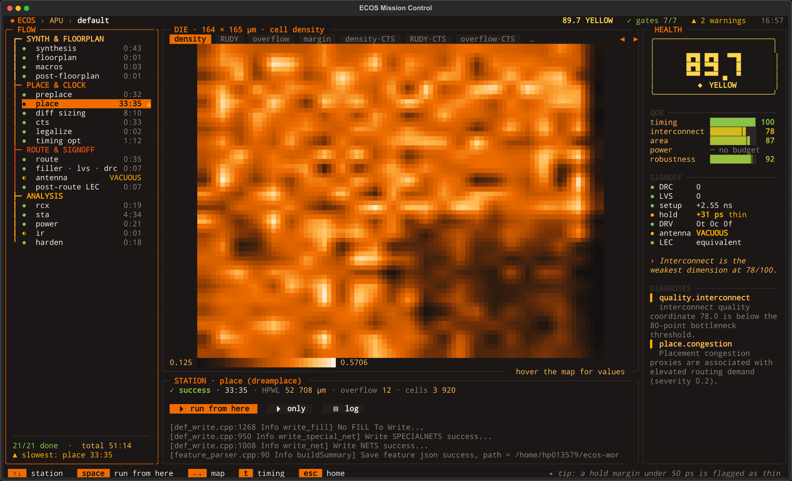

# ecctui

Terminal UI for the `ecc` RTL-to-GDS flow (`Textual`). Shells out to `ecc` and highlights unmasked signoff issues (DRVs, vacuous antenna checks, tight hold margins).



## Install & Run

Requires Python 3.11+ and `ecc` on `PATH` (or `--ecc PATH`).

```bash
pip install /path/to/ecctui          # or: ./run.sh [projects_root]
ecctui --root /path/to/projects [--ecc PATH] [--taskset CPUS]
```

## Keys

| Key | Scope | Action |
|---|---|---|
| `enter` / click | Home | Open project card |
| `s` / `/` / `esc` | Home | Cycle sort / filter / clear |
| `n` | Anywhere | New-chip wizard |
| `space` / `o` | Chip | Run from step / single step |
| `l` / `t` / `w` | Chip | Log / timing matrix / next workspace |
| `←` / `→` | Chip | Cycle die heat maps |
| `x` / `ctrl+p` / `?` / `q` | Anywhere | Stop run / command palette / help / quit |
